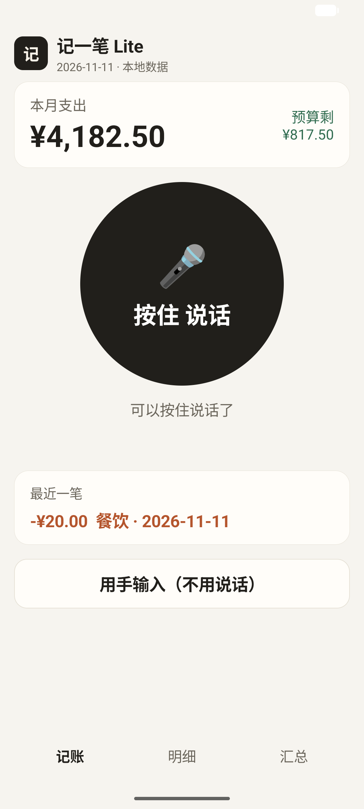
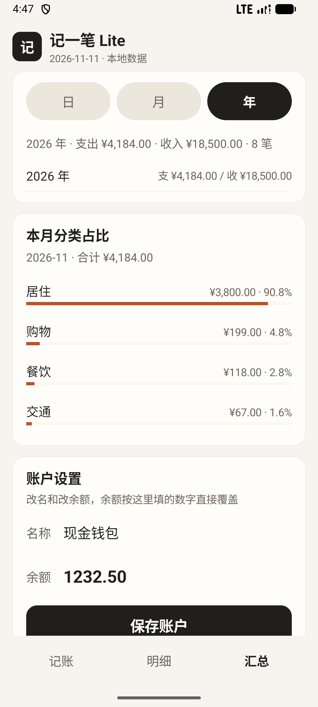

# Jiyibi Lite — Offline Voice Bookkeeping for Elderly Users

[](https://github.com/renchengxiang/jiyibi-lite/actions/workflows/tests.yml)

> An Android bookkeeping app designed for elderly users: **hold the big button, say one sentence, done.**
> No internet, no account, no ads. Business logic: pure native Java + SQLite, no Gradle, no AndroidX, command-line build (sherpa-onnx AAR is Kotlin-compiled; kotlin-stdlib is added at build time).
> Speech recognition runs **fully on-device** (sherpa-onnx + Paraformer-zh-small int8).

**[中文](README.md) · [Pruning rationale](docs/trim-decisions.md) · [Architecture analysis (anonymized)](docs/anon-report.md) · [Download APK](../../releases/latest)**

> The Gitee mirror does not host the APK (100MB per-file limit, this build is 134MB): download it from the [GitHub Release](https://github.com/renchengxiang/jiyibi-lite/releases/latest).

---

## The pitch

> After statically analyzing a mature bookkeeping app with **90 data entities**, I concluded that
> elderly users need exactly **3 domains**. So I built it with 4 tables, 5 screens and ~2700 lines
> of framework-free code — and dropped the other 87 entities *with written justification*.

The interesting part is not "yet another expense tracker". It's that three claims are verifiable:
**pruning has a decision table, speech has real numbers, engineering has automated tests.**

## Why 3 tabs instead of 30

| Decision | Rationale |
|---|---|
| Keep only Record / Budget / Summary | Users forget how to navigate; the person installing the app is their adult child |
| Drop assets / liabilities / investing (~40 domains) | Large assets are managed by the children; credit-card billing cycles and mortgage amortization exceed the mental model |
| Drop cloud account & sync | Cloud forces encryption, backup and key management. *Data never leaving the device* is the cheapest security design |
| Drop accessibility-based auto-capture | Watching window content of 28 apps reads as "my phone is being spied on" |
| On-device ASR instead of cloud streaming | Cloud ASR is more accurate but costs login + subscription + **audio leaving the device** — financial conversations shouldn't |

Entity-by-entity mapping (90 → kept/dropped + one-line reason): **[docs/trim-decisions.md](docs/trim-decisions.md)**.
Architecture and trade-offs of the analyzed product: **[docs/anon-report.md](docs/anon-report.md)** (anonymized).

## Architecture

```
MainActivity (shell: header + content + tab bar)
├── VoicePage     big-button state machine + confirm card (Asr → VoiceParser → Db)
├── ListPage      filters, tap-to-edit, ✕ with confirm dialog
├── SummaryPage   day/month/year + category shares + account + budget + CSV export
├── DetailPage    prefill / save / delete
├── AddPage       manual entry
├── Ui            widget factory (colors, cards, big buttons, segmented control)
├── PageContract  page ↔ shell callback contract
├── VoiceParser   hotword correction + Chinese numerals + amount/category extraction (pure Java, unit-testable)
├── Asr           sherpa-onnx wrapper (AudioRecord / VAD / OfflineRecognizer)
├── Db            SQLite: account / category / bill / budget
└── CsvExporter   MediaStore export (no permissions on Android 10+)
```

All classes are under 400 lines; the shell dropped from 1310 → 222 lines when split by page.

## Three engineering decisions in the offline speech pipeline

1. **Widen the decode beam** — `conf/model.conf`: `beam 12→20`, `lattice-beam 4→6`, `max-active 5000→8000`. Trade latency for accuracy; on-device there is no concurrency to protect.
2. **Hotword correction layer** — the small model is unstable on high-frequency measure words (会/快/愧 → 块, 搅 → 角, 猫/冒 → 毛). Same-sound mapping runs *before* parsing, longest-pattern-first (`会五→块五`) so digits aren't corrupted.
3. **Chinese numerals and elliptical speech** — `三十块五`=30.5, `三千八`=3800, `一万二`=12000, `128角6`=128.6, all in plain Java — **no Android dependency, so it runs in CI**.

## Tests

```bash
bash tools/run-parser-tests.sh     # 36 assertions: amounts / type / category / hotwords / edge cases
bash tools/check-sensitive.sh      # pre-release compliance: 8 sensitive patterns must be 0 hits
```

`run-parser-tests.sh` uses only `javac` + `java` (no JUnit, no Gradle) and the *same* script runs locally and in GitHub Actions — the CI badge reflects real assertions, not a build that merely compiles.

## Real-device ASR evaluation (2026-11-12, PHB110 / ColorOS)

8 short bookkeeping utterances, end-to-end after sherpa-onnx + Paraformer:

| Recognized text | Amount | Category | Verdict |
|---|---|---|---|
| 买菜三十五 | 35.00 | Food | ⚠️ "块" dropped, off by 4.5 |
| 搭车二十五 | 25.00 | Transport | ✅ |
| 交房租三千八 | 3800.00 | Housing | ✅ |
| 医院挂号二十块钱 | 20.00 | Medical | ⚠️ off by 0.05 |
| 买药一百二十八块六 | 128.60 | Medical | ✅ |
| 地铁充值二十五 | 25.00 | Transport | ✅ |
| 午块二十八块五 | 28.50 | Food (hotword fixed) | ⚠️ wrong char in category word |
| 买直径一百九十九 | 199.00 | Shopping | ⚠️ wrong char, amount correct |

Both metrics are reported, to avoid cherry-picking:

- **Bookable rate 8/8** — every utterance yielded a valid amount that can be confirmed
- **Amount+category exact rate 5/8 = 62.5%** — strict per-utterance judgement

One false trigger ("没有") was correctly rejected. Remaining errors are acoustic:
the measure word "块" gets elided, losing the decimal part.

Desktop TTS baseline (same 10 utterances): Vosk small 7/10, Paraformer 10/10, SenseVoice 10/10.
Full investigation (6 hypotheses, spectral evidence, a reversed conclusion): [docs/asr-diagnosis.md](docs/asr-diagnosis.md).

## Build (no Gradle)

```bash
# Requires: Android SDK build-tools 36.1.0, android-36, JDK 17 (Android Studio's JBR is fine)
bash build.sh        # aapt2 → javac → d8 → zipalign → apksigner → app-debug.apk
```

The script also unpacks dependencies from `libs/*.aar`, warns and degrades gracefully when the speech model is missing, and signs with your local debug keystore.

### Fetch the speech model

The 78MB model is not committed. Get `sherpa-onnx-paraformer-zh-small-2024-03-09.tar.bz2`
from the [sherpa-onnx model releases](https://github.com/k2-fsa/sherpa-onnx/releases/tag/asr-models)
(Apache-2.0), then:

```bash
mkdir -p assets/model-paraformer
cp model.int8.onnx tokens.txt assets/model-paraformer/
```

`libs/sherpa/` (AAR extract + kotlin-stdlib) is vendored. arm64-v8a only.
Without the model the app still builds and runs; only the voice button is unavailable.

## Install

```bash
adb install -r app-debug.apk
```

minSdk 26 (Android 8.0), targetSdk 36. Single permission: `RECORD_AUDIO`. `allowBackup=false`.

## Screens

| Home (voice) | Bills | Summary | Confirm |
|---|---|---|---|
|  |  |  |  |

## Privacy

- All data lives in a local SQLite database. No network permission, no account, no upload.
- Speech recognition is on-device (Paraformer); audio is never written to disk or sent anywhere.
- Migration: Summary → *Export all bills* → CSV in the system **Downloads** folder (UTF-8 with BOM, opens cleanly in Excel).

## Known limits (stated honestly)

| Limit | Current state | Alternative |
|---|---|---|
| Chinese accuracy | 8/8 real utterances bookable, 5/8 exact; "块" elision loses decimals | Larger model / linguistic rescoring (unverified) |
| APK size | 144MB (78MB model + 31MB runtime) | Download on first launch (rejected: breaks "works out of the box") |
| Android ≤9 | CSV falls back to app-private dir with the path shown | No back-port (negligible share) |
| Multi-account / multi-book | Not supported; single default account | Deliberate cut, see decision table |
| At-rest encryption | Plain SQLite (data never leaves the device) | If the device gets shared, add SQLCipher first |

## License

Code: MIT. Paraformer-zh-small, sherpa-onnx and kotlin-stdlib are Apache-2.0.
