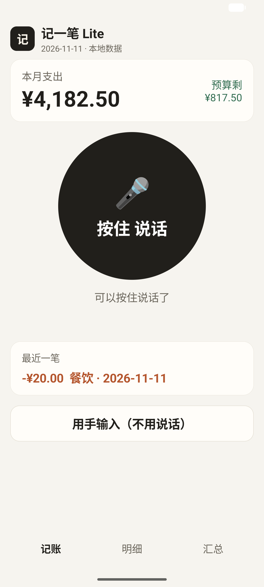
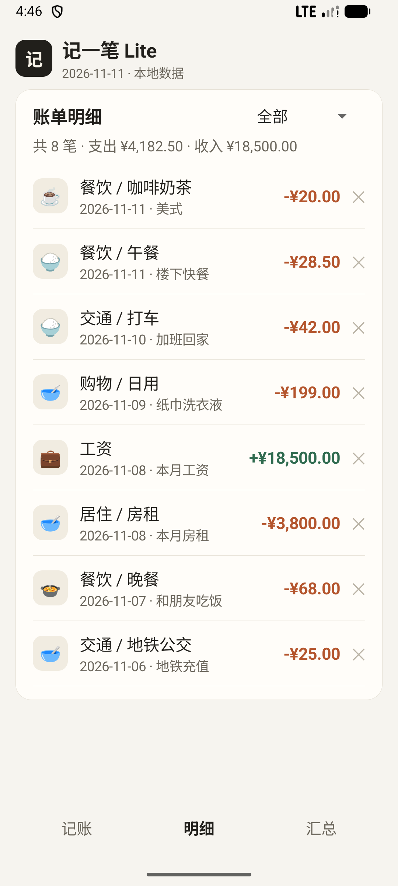
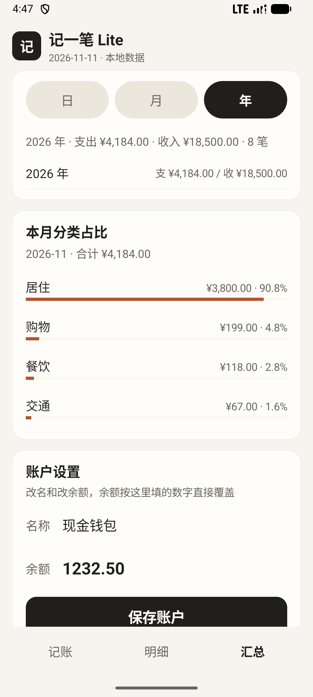
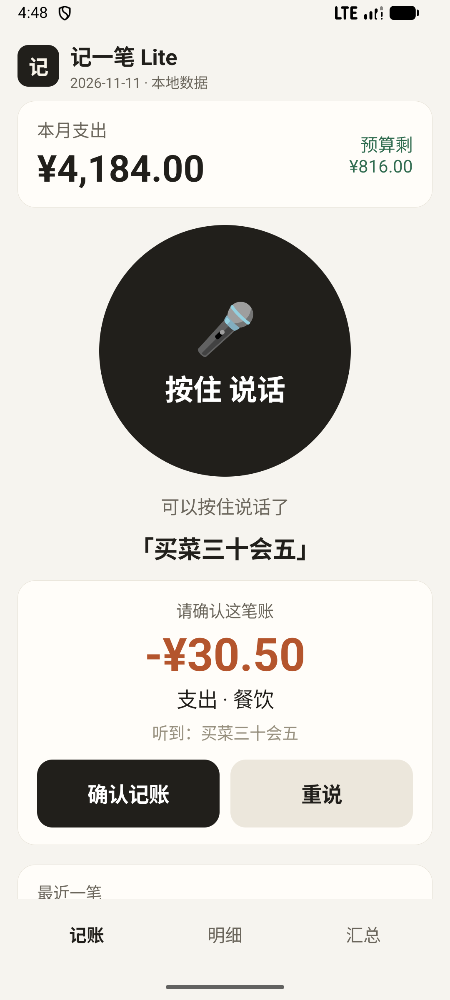

# 记一笔 Lite

[](https://github.com/renchengxiang/jiyibi-lite/actions/workflows/tests.yml)

> 给老人用的**离线语音记账** Android App。按一下、说一句，钱就记上了——不联网、不注册、没有广告。
> 业务逻辑纯原生 Java + SQLite，无 Gradle / 无 AndroidX，命令行构建（仅 sherpa-onnx AAR 由 Kotlin 编译，构建时引入 kotlin-stdlib）；语音识别跑**端侧离线模型**（sherpa-onnx + Paraformer-zh-small）。

**[English](README.en.md) · [裁剪决策表](docs/trim-decisions.md) · [架构分析报告（匿名）](docs/anon-report.md) · [下载 APK](../../releases/latest)**

> Gitee 镜像不承载 APK 附件（单文件上限 100MB，本包 134MB）：下载请用 [GitHub Release](https://github.com/renchengxiang/jiyibi-lite/releases/latest)。

---

## 一句话定位

> 逆向分析了一款 90 个实体的成熟记账产品后，我判断**老人记账只需要 3 个域**，
> 于是用 4 张表、5 个页面、约 2700 行零框架依赖的代码把它做出来——其余 87 个实体是被有依据地砍掉的。

这个仓库的价值不在"又一个记账 App"，而在三件事有据可查：**裁剪有决策表、语音有真实数据、工程有自动测试。**

## 为什么只有 3 个页签（而不是 30 个）

| 决策 | 依据 |
|---|---|
| 只保留 记账 / 预算 / 汇总 | 目标用户是"记不住操作、也不觉得自己需要记账"的老人，入口是替他们装机的子女 |
| 砍掉资产/负债/投资（近 40 个域） | 大额资产由子女管理，信用卡账单日、房贷摊薄超出老人心智模型 |
| 砍掉云账号与同步 | 引入云就要连带做加密、备份、密钥管理；"数据不出设备"是最省成本的安全设计 |
| 砍掉无障碍自动记账 | 监听 28 个 App 的窗口内容，对老人是"手机被监视"的不安感 |
| 语音走端侧离线模型 | 云端流式 ASR 识别率更好，但代价是登录 + 会员 + **音频离开设备**——财务对话不该外传 |

逐条映射（90 实体 → 保留/砍掉 + 理由）见 **[docs/trim-decisions.md](docs/trim-decisions.md)**；目标产品的架构与取舍见 **[docs/anon-report.md](docs/anon-report.md)**（已匿名化：不含应用名/包名/域名/指纹）。

## 架构

```
MainActivity (骨架: 顶栏 + 内容区 + 页签)
├── VoicePage     语音记账：大圆按钮状态机 + 确认卡（Asr → VoiceParser → Db）
├── ListPage      明细：类型筛选 / 点行进编辑 / ✕ 确认删除
├── SummaryPage   汇总：日·月·年 + 分类占比 + 账户设置 + 预算 + CSV 导出
├── DetailPage    编辑：回填 / 保存 / 删除
├── AddPage       手输：类型·金额·分类·日期·备注
├── Ui            控件工厂（颜色 / 卡片 / 大按钮 / 分段器）
├── PageContract  页面 ↔ 骨架回调契约
├── VoiceParser   热词纠错 + 中文数字 + 金额/分类抽取（纯 Java，可单测）
├── Asr           sherpa-onnx 封装（AudioRecord / VAD / OfflineRecognizer）
├── Db            SQLite：account / category / bill / budget
└── CsvExporter   MediaStore 导出（Android 10+ 免权限）
```

| 文件 | 行数 | 职责 |
|---|---|---|
| MainActivity | 222 | 骨架与导航 |
| VoicePage | 340 | 语音页 |
| SummaryPage | 314 | 汇总页 |
| Db | 750 | 数据层 |
| VoiceParser | 250 | 文本 → 账单 |
| 其余 | <200 各 | 单页 / 单职责 |

## 离线语音链路的三个工程决策

1. **先录完整句再整句解码**（不是边录边解）：手机 CPU 一旦解码慢于实时就会丢音频帧，识别退化成 2~4 字碎片。整句离线解码无此约束。
2. **采集质量修正**：`AudioSource.MIC` + 20ms 帧能量 VAD 裁头尾静音 + 峰值归一化。真机实测 RMS 1123→4967，语音高频谐波恢复。
3. **引擎选型（见 [ADR-005](docs/03-tech/adr/ADR-005-paraformer-small.md)）**：Vosk small 在真人语音上系统性出错，改用 **Paraformer-zh-small int8（78MB）**，同批真人录音与 10 句 TTS 全对；SenseVoice（228MB）精度相同但体积 3 倍，未采用。

另有**热词纠错层**：对"块/角/元"这类高频量词（会/快/愧→块，搅→角，午块→午饭）做同音映射；`三十块五`=30.5、`三千八`=3800、`128角6`=128.6 等中文数字在纯 Java 里处理——**不依赖 Android，可直接在 CI 跑单测**。

## 测试与质量

```bash
bash tools/run-parser-tests.sh     # 36 条断言：金额 / 类型 / 分类 / 热词纠错 / 边界
bash tools/check-sensitive.sh      # 发布前合规自查：8 个敏感串必须 0 命中
```

`tools/run-parser-tests.sh` 只用 `javac` + `java`（无 JUnit、无 Gradle），同一份脚本在本地和 GitHub Actions 里跑，因此 README 顶部的 CI 徽标反映的是真实断言结果。

## 真机语音评测（2026-11-12，PHB110 / ColorOS）

8 句记账短句，sherpa-onnx + Paraformer 识别后的**端到端入账**结果：

| 识别文本 | 解析金额 | 分类 | 判定 |
|---|---|---|---|
| 买菜三十五 | 35.00 | 餐饮 | ⚠️「块」被吞，差 4.5 |
| 搭车二十五 | 25.00 | 交通 | ✅ |
| 交房租三千八 | 3800.00 | 居住 | ✅ |
| 医院挂号二十块钱 | 20.00 | 医疗 | ⚠️ 差 0.05 |
| 买药一百二十八块六 | 128.60 | 医疗 | ✅ |
| 地铁充值二十五 | 25.00 | 交通 | ✅ |
| 午块二十八块五 | 28.50 | 餐饮（热词修复）| ⚠️ 分类错字 |
| 买直径一百九十九 | 199.00 | 购物 | ⚠️ 分类词错，金额对 |

两套口径都列出，避免选择性引用：

- **可入账率 8/8**：每句都解出了有效金额并可确认入账
- **金额+分类全对率 5/8 = 62.5%**：逐条严格判定

另有 1 次误触（「没有」）被正确拒绝。剩余误差集中在声学层「块」被吞导致小数位丢失，属已知边界。

桌面 TTS 对照（同批 10 句）：Vosk small 7/10、Paraformer 10/10、SenseVoice 10/10。
完整排查过程（6 轮假设、频谱证据、结论翻案）见 [docs/asr-diagnosis.md](docs/asr-diagnosis.md)。

## 构建（不依赖 Gradle）

```bash
# 依赖：Android SDK build-tools 36.1.0、android-36、JDK 17（Android Studio 自带 JBR 即可）
bash build.sh        # aapt2 → javac → d8 → zipalign → apksigner，产物 app-debug.apk
```

构建脚本自动做三件事：从 `libs/*.aar` 解包依赖、缺少语音模型时给出提示并降级为"仅手输"、用本机 debug keystore 签名。

### 准备语音模型

仓库不含 78MB 的模型文件（体积原因）。从 sherpa-onnx 官方发布页获取：

```bash
# 下载 sherpa-onnx-paraformer-zh-small-2024-03-09.tar.bz2 后：
mkdir -p assets/model-paraformer
cp model.int8.onnx tokens.txt assets/model-paraformer/
```

模型来源：<https://github.com/k2-fsa/sherpa-onnx/releases/tag/asr-models>（Apache-2.0）。
`libs/sherpa/` 里的 AAR 解包产物与 kotlin-stdlib 已随仓库提供。
缺模型时 App 仍可构建运行，语音按钮会提示"准备中"，手输不受影响。

> 只构建 arm64-v8a：32 位设备不支持（占比可忽略）。

## 安装

```bash
adb install -r app-debug.apk     # 或把 APK 传到手机点安装（需允许未知来源）
```

minSdk 26（Android 8.0）/ targetSdk 36；仅申请 `RECORD_AUDIO` 一项权限；`allowBackup=false`。

## 页面预览

| 首页（语音） | 明细 | 汇总（日/月/年） | 确认卡 |
|---|---|---|---|
|  |  |  |  |

## 数据与隐私

- 所有账单存在本机 SQLite（`Custom.db` 等价于应用私有库），**不联网、不上传、无账号**。
- 语音识别在本机完成（Paraformer 离线模型），音频不落盘、不外传。
- 换手机：汇总页「导出全部账单」→ CSV 落到系统「下载」目录（UTF-8 带 BOM，Excel 直接打开不乱码）。

## 已知边界（诚实记录）

| 边界 | 现状 | 备选方案 |
|---|---|---|
| 中文识别率 | Paraformer 真人 8 句全部入账、5 句全对；"块"被吞导致小数丢失 | 更大模型 / 语言学重打分（未验证） |
| 模型体积 | APK 144MB（模型 78MB + 运行时 31MB） | 首次启动下载（违背"开箱即用"，未采纳） |
| Android 9 及以下 | CSV 落应用私有目录并提示路径 | 不做反向适配（覆盖设备占比极低） |
| 多账户/多账本 | 不支持，单默认账户 | 有意砍掉，见决策表 |
| 数据加密 | 数据库明文（数据不出设备） | 若要分享设备，优先补 SQLCipher |

## 目录结构

```
├── AndroidManifest.xml      仅 RECORD_AUDIO
├── build.sh                 aapt2 + javac + d8 + zipalign + apksigner
├── java/com/yimu/lite/      10 个源文件（见架构）
├── assets/model-paraformer/ Paraformer int8 模型（不入库）
├── libs/sherpa/             sherpa-onnx AAR(arm64) + kotlin-stdlib
├── tools/                   解析器单测 + 合规自查
└── docs/                    裁剪决策表 / 架构报告 / 截图
```

## 许可

代码 MIT。语音模型 Paraformer-zh-small 与 sherpa-onnx 均为 Apache-2.0；kotlin-stdlib 为 Apache-2.0。
